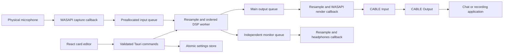

# V1 architecture

The application edits an ordered mono audio chain and routes a physical microphone to an installed VB-CABLE endpoint. React controls the pipeline; Rust owns all audio processing and device streams.

- `src/app/src/model.ts` owns card identity, insertion, ordering, duplication, presets and frontend settings validation. Instances have independent IDs and parameters.
- `src/app/src/filters.json` defines the shared filter catalog and numeric parameter ranges. Rust validates the same metadata before constructing a chain.
- `src/app/src-tauri/src/dsp.rs` implements frequency shift in Hz, high-pass, low-pass, gain and distortion. Parameter and bypass changes ramp over 10 ms. Frequency shift is additive translation, not musical pitch shifting.
- `graph.rs` preserves processor state for parameter edits and warms/crossfades replacement chains over 20 ms. Delay compensation also crossfades when latency increases. Peak algorithm delay is retained until stop/start.
- `audio.rs` manages stable WASAPI endpoint IDs, bounded queues, a DSP worker and device errors. Callbacks wake the worker; its progress does not depend on Windows delivering a 1 ms sleep. Recoverable driver discontinuities are counted; actual device failures stop the affected route.
- `clock.rs` adapts microphone and monitor clocks independently through asynchronous sinc resampling. Main output demand controls production. Internal processing uses 48 kHz, 256-frame blocks.
- `settings.rs` validates sessions, atomically replaces settings and preserves corrupted originals. Portable mode uses `data/` beside the executable; installed mode uses the app data directory. Loading settings does not start microphone capture.
- `template.rs` is a compiled custom processor template with an adjustable `amount_db` control. Registration is described in `filter-development.md`; V1 has no runtime script or DLL loader.

The audio callbacks and DSP worker use preallocated processing buffers. Graph construction and retirement happen outside processing. Live edits use the latest pending graph, and a new graph waits until the current transition finishes.

V1 ships three built-in presets: raw, metal and telephone. Runtime device changes require stop/start. Headphone monitoring is optional and defaults off. VB-CABLE is an external system driver installed through its official administrator installer; this application does not implement a virtual microphone driver.

The 64-card configuration limit bounds memory, not latency or CPU for every chain. Hardware acceptance is separate from unit tests: measure microphone-to-CABLE latency and run the sustained hardware test. See `filter-development.md` for the opt-in commands and `implementation-checkpoint.md` for actual results and outstanding work.
